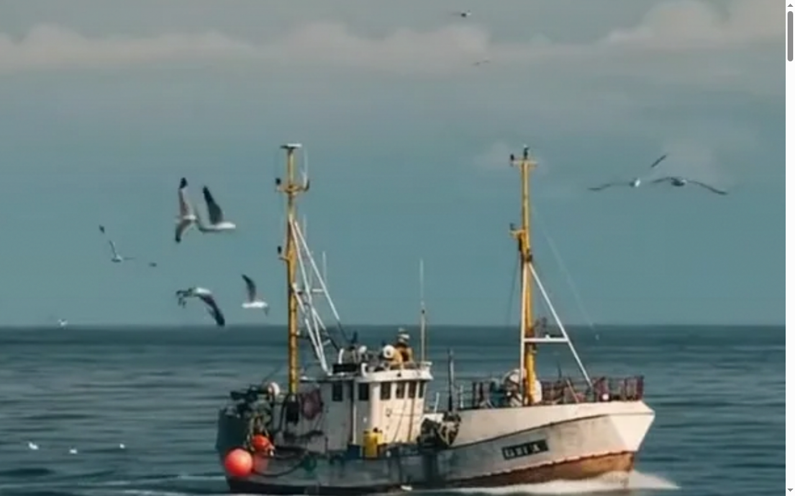
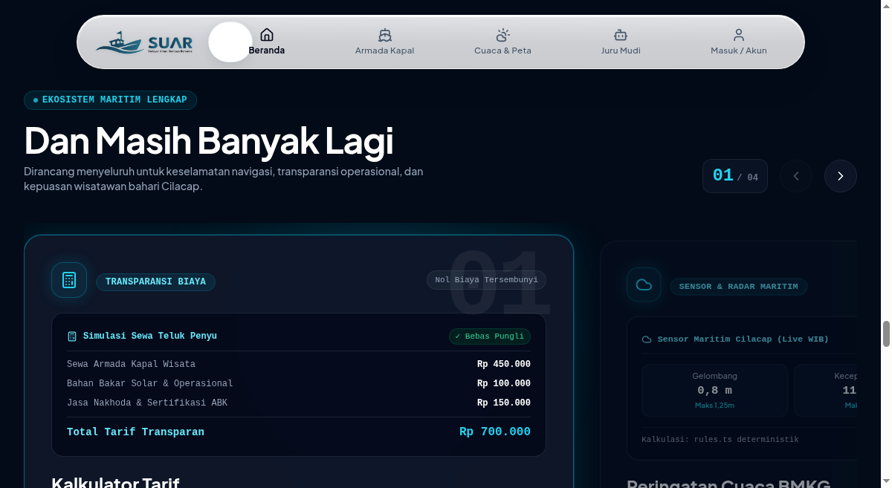
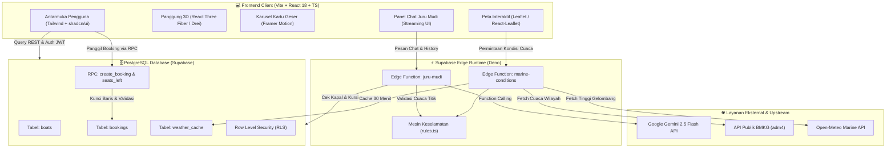

<div align="center">


# 🛥️ SUAR

### *Platform Digital Terpadu Berbasis Artificial Intelligence (AI) untuk Menghubungkan Nelayan dan Wisatawan di Pesisir Cilacap*

[](https://github.com/MuhammadHadistRifannan/Angkara/actions/workflows/ci.yml)
[](https://github.com/MuhammadHadistRifannan/Angkara/actions/workflows/deploy.yml)
[](https://vitejs.dev/)
[](https://react.dev/)
[](https://www.typescriptlang.org/)
[](https://threejs.org/)
[](https://motion.dev/)
[](https://supabase.com/)
[](https://tailwindcss.com/)
[](https://deepmind.google/technologies/gemini/)

**Karya untuk Kompetisi IT RUSH 2026 — Subtema Ekonomi dan Pemberdayaan Masyarakat**
*“Berlayar Aman, Berdaya Bersama.”*

[Demo Aplikasi](https://suar-cilacap.vercel.app) • [Dokumentasi Deployment](docs/DEPLOYMENT.md) • [Laporan Arsitektur](2026-11-08-juru-mudi-design.md)

</div>

---

## 📌 Daftar Isi

1. [Latar Belakang & Masalah](#-latar-belakang--masalah)
2. [Solusi Inovatif: SUAR](#-solusi-inovatif-suar)
3. [Tampilan Antarmuka Landing Page Terkini](#-tampilan-antarmuka-landing-page-terkini)
4. [Fitur Unggulan](#-fitur-unggulan)
5. [Akun Demo](#-akun-demo)
6. [Arsitektur Sistem & Alur Kerja](#-arsitektur-sistem--alur-kerja)
7. [Tech Stack](#-tech-stack)
8. [Panduan Instalasi & Menjalankan Lokal](#-panduan-instalasi--menjalankan-lokal)
9. [Pengujian & Verifikasi Kualitas (TDD)](#-pengujian--verifikasi-kualitas-tdd)
10. [Pengungkapan Penggunaan AI](#-pengungkapan-penggunaan-ai)
11. [Daftar Aset & Lisensi](#-daftar-aset--lisensi)
12. [Profil Tim Pengembang](#-profil-tim-pengembang)
13. [Lisensi & Penafian](#-lisensi--penafian)

---

## 🌊 Latar Belakang & Masalah

Kawasan pesisir Cilacap — dengan titik berangkat Teluk Penyu dan Pelabuhan Tanjung Intan, serta destinasi Pantai Karang Bolong, Pantai Permisan, Mercusuar Cimiring, dan Laguna Segara Anakan — memiliki potensi pariwisata bahari dan ekonomi maritim yang luar biasa. Namun, operasional pelayaran kapal wisata rakyat saat ini menghadapi berbagai tantangan krusial:

1. **Ketidakpastian Cuaca Maritim & Risiko Keselamatan**:
   Wisatawan dan operator kapal kayu sering mengandalkan perkiraan kasat mata tanpa akses data gelombang laut dan kecepatan angin yang terukur. Cuaca ekstrem dapat berubah cepat dan membahayakan pelayaran.
2. **Proses Reservasi Tradisional & Rawan Overbooking**:
   Pemesanan masih mengandalkan pencatatan manual atau pesan instan tanpa sinkronisasi ketersediaan kursi secara *real-time*, memicu ketidakpastian kapasitas dan potensi sengketa di dermaga.
3. **Ketidakterbukaan Tarif & Asimetri Informasi**:
   Wisatawan luar daerah kerap menghadapi variasi tarif yang membingungkan tanpa rincian biaya yang transparan dan perlindungan uang muka (DP).
4. **Minimnya Edukasi Checklist Kelaikan Kapal**:
   Operator lokal membutuhkan panduan yang jelas mengenai checklist keselamatan sebelum berlayar dan pencatatan kelengkapan kapal.

---

## 💡 Solusi Inovatif: SUAR

**SUAR** mentransformasi ekosistem wisata maritim pesisir menjadi platform digital modern berbasis *Safety-First*. Aplikasi ini menyatukan:

- 🤖 **Juru Mudi AI**: Asisten pintar berbasis **Google Gemini 2.5 Flash** yang beroperasi secara *grounded* terhadap database kapal dan mesin keselamatan deterministik.
- 🌊 **Mesin Keselamatan Cuaca Maritim Deterministik**: Prakiraan cuaca darat dari BMKG digabung dengan tinggi gelombang laut dari model maritim Open-Meteo, dengan batas konservatif perahu nelayan (angin 15 knot, gelombang 1,25 m). Status berlayar harian juga dapat diinput langsung oleh operator setiap pagi.
- 🗺️ **Peta Interaktif Pesisir Cilacap**: Visualisasi geografis dermaga, kondisi gelombang per jam, dan rekomendasi jendela waktu pelayaran teraman (07.00–15.00 WIB).
- ⚓ **Reservasi Aman & Transparan**: Mesin booking berbasis transaksi atomik PostgreSQL RPC dengan proteksi kelebihan muatan (*anti-overbooking*), pembayaran DP 30% melalui Midtrans, dan kontrol akses ketat (*Row Level Security*).
- 🌐 **Pengalaman Visual Imersif**: Landing page interaktif dengan Three.js / React Three Fiber panggung 3D, efek zoom sinematik, dan karusel kartu geser interaktif.

---

## 🖼️ Tampilan Antarmuka Landing Page Terkini

### 1. Hero Section Sinematik & Liquid Navigation

- **Deep Zoom-Out Effect**: Saat pertama kali halaman dibuka, viewport menampilkan sudut pandang laut yang tenang, lalu melakukan transisi zoom halus saat digulir ke bawah.
- **Scroll-Driven Typewriter dengan Garansi Keterbacaan**: Judul hero berganti seiring scroll dengan proteksi keterbacaan (judul saat ini otomatis ditampilkan utuh sebelum berganti ke judul berikutnya).
- **LiquidNav Floating Navbar**: Bilah navigasi melayang transparan berkaca buram (*glassmorphism*) dengan logo SUAR bernuansa biru bahari, indikator highlight aktif, serta animasi bounce entrance & exit yang responsif terhadap scroll kembali ke atas layar.



---

### 2. Panggung 3D Interaktif: “Lima Alasan Berlayar Tanpa Ragu”

Panggung visual 3D berbasis **React Three Fiber (@react-three/fiber)** dan **Drei** yang terhubung langsung ke mesin scroll sentry, dilengkapi spotlight terpusat dan pelacakan koordinat dinamis ke slot DOM:

1. **🛡️ Listing Terverifikasi** (*3D Shield Model*): Kapal tampil di daftar beserta lencana Terverifikasi.
2. **📅 Kalender Booking** (*3D Calendar Model*): Pilih tanggal dan lihat sisa kursi. Bila kuota minimal belum terpenuhi, trip bisa digabung agar biaya terbagi.
3. **💳 Pembayaran Online** (*3D Credit Card Model*): Bayar uang muka 30% di awal, sisanya dibayar saat berangkat.
4. **📊 Dashboard Analitik** (*3D Bar Chart Model*): Operator kapal memantau grafik booking 14 hari dalam satu halaman.
5. **⚓ Paket Wisata Bahari** (*3D Anchor Model*): Paket kurasi lokal yang siap dipesan, misalnya sunset Teluk Penyu dan susur mangrove.

> [!NOTE]
> Dilengkapi **WebGL Error Boundary Fallback** otomatis: jika browser pengguna tidak mendukung akselerasi 3D WebGL, tampilan otomatis beralih ke grid 2D yang elegan tanpa memutus alur browsing pengguna.


---

### 3. Karusel Kartu Geser Interaktif: “Dan Masih Banyak Lagi”

Mengadopsi mekanika visual interaktif modern dengan gestur drag / sentuh layar dan fisika pegas (*spring physics*):

- **Watermark Angka Raksasa**: Tipografi mono berani (`01`, `02`, `03`, `04`) pada setiap kartu.
- **Kontrol Navigasi & Counter**: Penunjuk langkah numerik aktif (`01 / 04`), tombol melingkar *Prev/Next*, serta tab progress bersegmen di bagian bawah.
- **Widget Visual Eksklusif per Kartu**:
    - **01. E-Tiket Digital**: Tiket digital dengan kode QR yang ditunjukkan ke nakhoda di dermaga saat berangkat.
    - **02. Peringatan Cuaca BMKG**: Prakiraan gelombang dan angin terbaru, lengkap dengan status Aman, Waspada, atau Tunda untuk tiap jenis kapal.
    - **03. Rating Terverifikasi**: Ulasan hanya bisa ditulis penumpang yang sudah menyelesaikan pelayaran, bukan dari sembarang akun.
    - **04. Asisten AI Juru Mudi**: Tanya rekomendasi waktu berlayar, cari kapal yang cocok, dan panduan keselamatan sebelum berangkat.



---

### 4. Peta Maritim Interaktif & Pemantau Keselamatan Titik Keberangkatan

Peta geografis resolusi tinggi berbasis Leaflet yang memetakan titik berangkat utama (Teluk Penyu dan Pelabuhan Tanjung Intan), disertai status keselamatan deterministik.


---

## 🚀 Fitur Unggulan

### 1. 🤖 Asisten Pintar “Juru Mudi” (Gemini 2.5 Flash + Tool Calling)

- **Domain Khusus Maritim Cilacap**: Melayani pertanyaan rekomendasi kapal, jadwal pelayaran, estimasi tarif, informasi umum perizinan berlayar, dan kondisi cuaca.
- **Keselamatan Deterministik**: Asisten dilarang mengarang atau melunakkan status cuaca. Semua status keselamatan dihitung murni oleh aturan matematis sistem di `rules.ts`.
- **Kartu UI Interaktif Terstruktur**: Agen mengembalikan kartu interaktif kaya (*Boat Options*, *Weather Verdict*, *Safest Window*, dan *Booking Draft*) yang diverifikasi skema Zod.
- **Pertahanan Anti-Injeksi Prompt**: Dilindungi dari manipulasi pengguna (misal: memaksa asisten menyatakan kondisi aman saat cuaca berbahaya).
- **Wajib Login**: Bertanya ke Juru Mudi AI mengharuskan pengguna masuk akun terlebih dahulu (popup login di halaman landing).

### 2. 🌊 Mesin Keselamatan Deterministik Cuaca Maritim

- **Aturan Batas Konservatif Perahu Nelayan** (mengacu `thresholds.json`):
    - Batas kecepatan angin: **15 knot** ($\\approx 27,78\\text{ km/jam}$).
    - Batas tinggi gelombang signifikan: **1,25 meter**.
- **Logika Verdict**:
    - **Tunda**: Melebihi ambang batas, terdapat petir (*thunderstorm*), atau hujan lebat ekstrem.
    - **Waspada**: Kondisi mencapai $\\ge 80\\%$ batas ambang atau curah hujan $\\ge 5\\text{ mm/jam}$.
    - **Aman**: Seluruh parameter berada di bawah batas waspada.
    - **Fallback Unavailable**: Jika data gelombang `null`, status maksimal adalah **Waspada** dan **tidak pernah Aman**.
- **Jendela Pelayaran Teraman (*Safest Departure Window*)**: Menganalisis rentang jam operasional optimal (07.00–15.00 WIB) untuk menentukan hari dan jam terbaik berlayar.
- **Input Operator**: Status berlayar harian dapat diinput langsung oleh operator setiap pagi (Aman / Waspada / Tunda) dan menjadi penentu utama di konsol operator.

### 3. ⚓ Mesin Booking Atomik (PostgreSQL RPC `create_booking`)

- Transaksi database terkunci (*row-level locking* `SELECT FOR UPDATE`) untuk mencegah perebutan kursi (*race condition*).
- Menghitung sisa kursi otomatis dengan fungsi `seats_left()`.
- Pembayaran DP 30% melalui **Midtrans** (mode sandbox) — QRIS, Virtual Account Bank, Kartu Kredit/Debit Online, atau Bayar Tunai di Dermaga — dengan pelunasan di lokasi.
- E-tiket dengan status **Hangus** otomatis bila DP masih pending dan waktu keberangkatan sudah lewat.
- Error mapping berbahasa Indonesia: menangani penolakan jika kursi tidak cukup, tanggal lampau, kapal tidak beroperasi, atau belum masuk akun.

### 4. 🔐 Autentikasi Pengguna & Peran

- Dukungan **Masuk dengan Google (OAuth 2.0)** dan email/password melalui Supabase Auth.
- Pemisahan hak akses berbasis peran (*Role-Based Access Control*): Tamu (tanpa login), Wisatawan, Operator Kapal, dan Administrator.
- **Konsol Operator** (5 tab): Dashboard (statistik, grafik booking 14 hari, input status berlayar), Kapal Saya, Paket Wisata, Booking (manifest penumpang + check-in "Tandai Sudah Berangkat" + Chat Wisatawan via WhatsApp), Profil & Legalitas.
  > [!NOTE]
  > Penyimpanan status berlayar harian dan keterbacaan nomor HP wisatawan oleh operator membutuhkan dua pembaruan basis data yang masih menunggu diterapkan oleh pengelola basis data; sampai diterapkan, kedua fitur menampilkan pesan bahwa basis data belum diperbarui.
- **Konsol Admin** (6 tab): Verifikasi Operator, Moderasi Kapal, Moderasi Paket, Moderasi Ulasan, Pantauan Booking, dan Kontrol Berlayar (override status keselamatan). Admin ditunjuk manual lewat Supabase; tidak ada pendaftaran admin mandiri.

---

## 👤 Akun Demo

Untuk keperluan pengujian oleh juri, gunakan akun demo berikut di [https://suar-cilacap.vercel.app](https://suar-cilacap.vercel.app):

| Peran | Email | Password | Keterangan |
| --- | --- | --- | --- |
| **Wisatawan** | `wisatawan@suar.id` | `suardemo2026` | Dashboard wisatawan, tiket & e-tiket, profil |
| **Operator Kapal** | `operator@suar.id` | `Password123!` | Konsol operator (CV Samudra Jaya) |
| **Admin** | `admin@suar.id` | `Password123!` | Konsol admin platform |

> [!NOTE]
> Data kapal dan paket wisata yang tampil adalah **data demo untuk keperluan kompetisi**. Status berlayar diinput oleh operator berdasarkan prakiraan cuaca. Akun demo di atas hanya untuk pengujian dan bukan akun produksi.

---

## 🏗️ Arsitektur Sistem & Alur Kerja

Berikut adalah arsitektur aliran data menyeluruh aplikasi SUAR:



> [!NOTE]
> Catatan implementasi: saat ini tinggi gelombang di situs live diambil langsung dari Open-Meteo Marine (jalur langsung), karena Edge Function `marine-conditions` masih mengalami error saat dijalankan. Juru Mudi AI berjalan live melalui Edge Function `juru-mudi`.

---

## 🧰 Tech Stack

| Kategori | Teknologi yang Digunakan | Keterangan & Peran |
| --- | --- | --- |
| **Frontend Framework** | **Vite 5 + React 18** | *Single Page Application* (SPA) dengan rendering cepat dan modular |
| **Bahasa Pemrograman** | **TypeScript 5.8** | *Type safety* menyeluruh dari kontrak UI hingga payload backend |
| **3D Graphics & Canvas** | **Three.js + React Three Fiber + Drei** | Render model 3D interaktif GLTF dengan spotlight beam dan fallback 2D |
| **Motion & Animation** | **Framer Motion 14** | Animasi pegas karusel kartu geser, liquid navigation bar, dan gestur drag |
| **UI & Styling** | **Tailwind CSS + shadcn/ui** | Desain responsif, modern, glassmorphic, dan aksesibel |
| **Peta & Visualisasi** | **Leaflet + React-Leaflet + Recharts** | Peta interaktif dermaga Cilacap dan grafik booking operator |
| **Backend & BaaS** | **Supabase (PostgreSQL 15)** | Relasional DB, RLS, Storage, Auth OAuth Google, dan RPC atomik |
| **Serverless Runtime** | **Deno (Supabase Edge Functions)** | Menjalankan *microservices* `juru-mudi` & `marine-conditions` |
| **Kecerdasan Buatan (AI)** | **Google Gemini 2.5 Flash** | Model LLM penalaran agen maritim dengan pemanggilan tool terstruktur |
| **Pembayaran** | **Midtrans (Sandbox)** | Checkout DP 30% dengan pemilihan metode pembayaran |
| **Data Cuaca Eksternal** | **BMKG & Open-Meteo API** | Prakiraan darat BMKG tingkat kelurahan (`adm4`) dan model gelombang laut Open-Meteo |
| **Unit Testing** | **Vitest 2.1 + Testing Library** | Disiplin *Test-Driven Development* (TDD) — 59 berkas tes, 338 unit test (100% lulus) |
| **CI/CD & Hosting** | **GitHub Actions + Vercel** | Otomatisasi pengujian, *typecheck*, *build*, dan *deployment* produksi |

---

## ⚙️ Panduan Instalasi & Menjalankan Lokal

### Prasyarat

- **Node.js**: versi `20.x` atau `22.x` (direkomendasikan Node 22 LTS)
- **NPM**: bawaan Node.js
- Git terpasang di sistem operasi Anda

### 1️⃣ Clone Repository

```bash
git clone https://github.com/MuhammadHadistRifannan/Angkara.git
cd Angkara
```

### 2️⃣ Install Dependensi

```bash
npm ci
```

### 3️⃣ Konfigurasi Environment Variables

Salin berkas contoh konfigurasi lingkungan:

```bash
cp .env.example .env
```

Lalu lengkapi nilai konfigurasi Supabase dan Midtrans Anda di dalam `.env`:

```env
VITE_SUPABASE_PROJECT_ID="your-project-id"
VITE_SUPABASE_URL="https://your-project-id.supabase.co"
VITE_SUPABASE_PUBLISHABLE_KEY="your-anon-key"
VITE_MIDTRANS_CLIENT_KEY="your-midtrans-client-key"
VITE_MIDTRANS_IS_PRODUCTION="false"
MIDTRANS_SERVER_KEY="your-midtrans-server-key"
```

### 4️⃣ Jalankan Server Pengembangan Lokal

```bash
npm run dev
```

Buka browser Anda di `http://localhost:5174` (atau `http://localhost:5173`).

### 5️⃣ Menjalankan Menggunakan Docker (Opsional)

Proyek telah dilengkapi dengan multi-stage Dockerfile yang mengoptimalkan image lokal (`node:22` dan `nginx:alpine`) tanpa perlu mengunduh image besar berulang kali:

```bash
# Menjalankan kontainer bundle produksi (Nginx) di http://localhost:8088
docker compose up -d app
# atau melalui npm script:
npm run docker:up

# Menjalankan kontainer mode pengembangan (HMR Live Reload) di http://localhost:5174
docker compose --profile dev up app-dev

# Menghentikan kontainer
docker compose down
# atau melalui npm script:
npm run docker:down
```

---

## 🧪 Pengujian & Verifikasi Kualitas (TDD)

Proyek ini dibangun dengan komitmen kualitas tinggi dan disiplin **Test-Driven Development (TDD)** yang ketat:

```bash
# Menjalankan seluruh test suite unit & integrasi (Vitest)
npm test

# Menjalankan verifikasi tipe TypeScript tanpa emit berkas
npm run typecheck

# Menjalankan linter kode
npm run lint

# Menjalankan build bundle produksi
npm run build

# Menjalankan suite evaluasi agen juru-mudi
EVAL_URL=https://<project-ref>.supabase.co/functions/v1/juru-mudi EVAL_ANON_KEY=<anon-key> npm run eval
```

> [!NOTE]
> Proyek memiliki **59 berkas tes dengan 338 unit test (100% lulus / PASS)** yang mencakup mesin keselamatan maritim, format perizinan, perhitungan tarif, penanganan galat RPC booking, karusel kartu geser, komponen UI peta, konsol operator, dan mesin assertion evaluasi AI. Angka ini diverifikasi pada commit `abb118c` (23 Nov 2026).

---

## 🤖 Pengungkapan Penggunaan AI

Sesuai ketentuan kompetisi IT RUSH 2026, seluruh penggunaan kecerdasan buatan (AI) dalam karya ini diungkapkan secara terbuka:

| No. | Nama Aplikasi AI / API | Fungsi / Bagian Karya yang Didukung | Kustomisasi / Pengaturan |
| --- | --- | --- | --- |
| 1 | **Google Gemini API (Gemini 2.5 Flash)** | Komponen fungsional asisten cerdas "Juru Mudi AI": pemrosesan bahasa alami (NLP), rekomendasi wisata bahari, pencarian armada kapal, dan penyajian kartu UI interaktif. | System prompt maritim pesisir Cilacap, pemanggilan fungsi terstruktur (skema Zod), pengamanan anti-prompt injection, multi-key failover manager, serta pembatasan akses baca (*read-only*, tidak dapat menulis ke database). |
| 2 | **AI Coding Assistant (Antigravity / Gemini CLI)** | Alat bantu penulisan dan perbaikan kode, peninjauan kode, pembuatan unit test (TDD), refactoring komponen, dan penyusunan draf dokumen. | Semua kode dan dokumen ditinjau, diuji, dan disesuaikan manual oleh tim; bukan hasil tempelan mentah. |

Selain itu, karya ini dikembangkan dari proyek **Angkara** ("Angkutan Segara") karya Muhammad Hadist Rifannan yang merupakan anggota tim ini. Pengembangan lanjutan atas Angkara menjadi SUAR dilakukan oleh tim dengan sepengetahuan dan izin tertulis Hadist, yang diberikan melalui grup WhatsApp tim. Detail lengkap aset dan deklarasi AI tersedia di [docs/CREDITS.md](docs/CREDITS.md).

---

## 🎨 Daftar Aset & Lisensi

Seluruh aset eksternal yang digunakan dalam proyek SUAR dipilih dengan cermat demi kepatuhan hak cipta dan lisensi terbuka (detail lengkap tersedia di [docs/CREDITS.md](docs/CREDITS.md)):

| Aset | Tipe / Format | Sumber / Penggunaan | Lisensi |
| --- | --- | --- | --- |
| **Font Utama (Plus Jakarta Sans)** | Google Fonts | Tipografi utama seluruh antarmuka (display & sans, dimuat dari Google Fonts) | Open Font License (OFL) |
| **Logo SUAR** | PNG / Vektor | Identitas resmi platform SUAR (desain orisinal tim) | Proprietary (Hak Cipta Tim SUAR) |
| **Video Hero Latar** | MP4 Video | Video rekaman kapal (Youtube) | [CC BY Youtube](https://youtu.be/ZOMrV1PZmfQ?si=WcfypLCCM43EOBf7) |
| **Foto Pantai Karang Bolong** | Foto (Wikimedia Commons) | Foto pesisir Karang Bolong oleh **Crisco 1492** | [CC BY-SA 4.0](https://creativecommons.org/licenses/by-sa/4.0/) |
| **Foto Sunrise Kapal** | Foto (Wikimedia Commons) | Foto kapal saat matahari terbit oleh **Wiaskara** | [CC BY-SA 4.0](https://creativecommons.org/licenses/by-sa/4.0/) |
| **Foto Perahu Mangrove** | Foto (Wikimedia Commons) | Foto perahu di kawasan mangrove oleh **FarisJamal** | [CC BY-SA 4.0](https://creativecommons.org/licenses/by-sa/4.0/) |
| **Foto Panorama Pesisir Selatan** | Foto (Wikimedia Commons) | Panorama pesisir selatan Nusakambangan oleh **Tyo Satriany** | [CC BY-SA 4.0](https://creativecommons.org/licenses/by-sa/4.0/) |
| **Model 3D Shield** | GLTF/GLB (`shield_protection_icon.glb`) | Model tameng perlindungan pada panggung 3D | CC Attribution / CC0 |
| **Model 3D Calendar** | GLTF/GLB (`calendar.glb`) | Model kalender booking | CC Attribution / CC0 |
| **Model 3D Payment Card** | GLTF/GLB (`payment_card.glb`) | Model kartu pembayaran online | CC Attribution / CC0 |
| **Model 3D Bar Chart** | GLTF/GLB (`analitik.glb`) | Model grafik analitik performa operator | CC Attribution / CC0 |
| **Model 3D Anchor** | GLTF/GLB (`anchor.glb`) | Model jangkar paket wisata bahari | CC Attribution / CC0 |
| **Ikon Antarmuka** | SVG / React Component | Koleksi ikon Lucide React | ISC License |
| **Peta Pesisir** | Map Tiles Leaflet | OpenStreetMap CartoDB Tiles | ODbL / OpenStreetMap Contributors |

---

## 👥 Profil Tim Pengembang

Karya ini dirancang dan dikembangkan dengan penuh dedikasi untuk kompetisi **IT RUSH 2026**:

<div align="center">

### 🏆 **Tim Belum Ada Namanya**

*Kolaborasi Mahasiswa Politeknik Negeri Cilacap untuk Transformasi Digital Maritim*

| Foto | Profil Anggota | Asal Instansi | Peran & Tanggung Jawab |
| --- | --- | --- | --- |
| 👩‍💼 | **Naysa Nida Setyowati**<br>`NIM: 240102090` | **Program Studi Teknik Informatika, Politeknik Negeri Cilacap** | **Ketua Tim**<br>• Membantu frontend, administrasi & quality control<br>• Dokumentasi dan kelengkapan berkas kompetisi |
| 👨‍💻 | **Bagas Wicaksono**<br>`NIM: 240102006` | **Program Studi Teknik Informatika, Politeknik Negeri Cilacap** | **Anggota / Frontend Developer**<br>• Desain antarmuka pengguna & komponen visual<br>• Implementasi peta interaktif & responsivitas mobile |
| 👨‍💻 | **Muhammad Hadist Rifannan**<br>`NIM: 240202107` | **Program Studi Teknik Informatika, Politeknik Negeri Cilacap** | **Anggota / Backend & AI Engineer**<br>• Arsitektur sistem & integrasi Edge Functions<br>• Mesin keselamatan cuaca & Gemini Agent<br>• Database schema, RPC, & CI/CD pipeline |
| 🎬 | **Muhammad Fikri Alfauzan**<br>`NIM: 240111051` | **Program Studi Teknologi Rekayasa Multimedia, Politeknik Negeri Cilacap** | **Anggota / Editing & Dokumentasi**<br>• Penyuntingan video demo dan materi presentasi<br>• Penyusunan dan finalisasi proposal |

</div>

---

## 📄 Lisensi & Penafian

- **Lisensi**: Proyek ini dilisensikan di bawah [MIT License](LICENSE).
- **Atribusi Proyek Dasar**: Platform ini dikembangkan dari **Angkara** ("Angkutan Segara") karya Muhammad Hadist Rifannan, anggota tim ini, dengan izin tertulisnya.
- **Penafian Data Cuaca**: Data cuaca diperoleh dari Badan Meteorologi, Klimatologi, dan Geofisika (BMKG) untuk prakiraan darat serta model laut Open-Meteo untuk tinggi gelombang. Informasi keselamatan pelayaran yang disajikan oleh asisten AI ditujukan sebagai panduan pendukung keputusan dan edukasi keselamatan (*decision-support system*), bukan pengganti instruksi resmi syahbandar pelabuhan (KSOP) setempat. Status berlayar harian diinput oleh operator berdasarkan prakiraan cuaca.

---

<div align="center">
  <sub>Dibuat dengan ❤️ dan semangat gotong royong masyarakat pesisir Cilacap • 2026</sub>
</div>