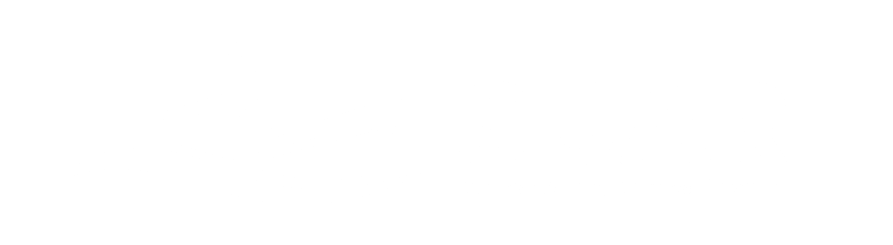
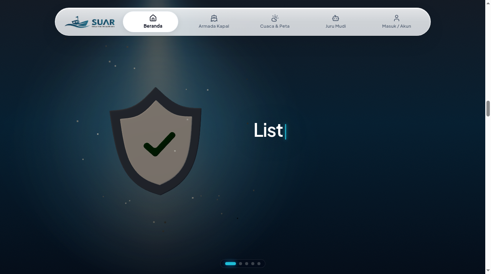
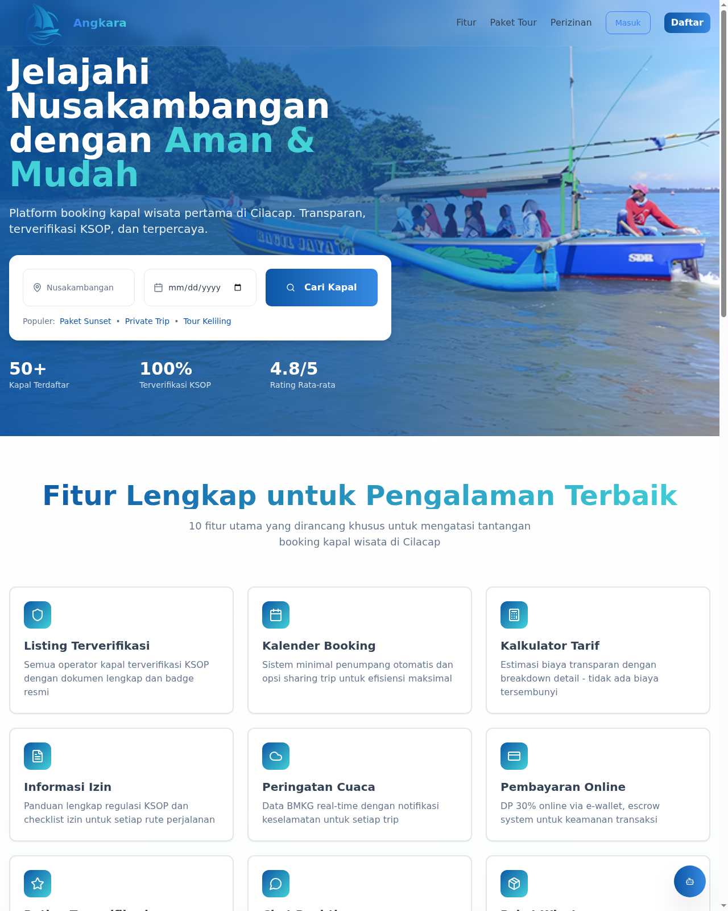

<div align="center">



# 🛥️ SUAR
### *Platform Reservasi Wisata Maritim Terpadu & Asisten Keselamatan Berlayar Cerdas*

[](https://github.com/MuhammadHadistRifannan/Angkara/actions/workflows/ci.yml)
[](https://github.com/MuhammadHadistRifannan/Angkara/actions/workflows/deploy.yml)
[](https://vitejs.dev/)
[](https://react.dev/)
[](https://www.typescriptlang.org/)
[](https://threejs.org/)
[](https://motion.dev/)
[](https://supabase.com/)
[](https://tailwindcss.com/)
[](https://deepmind.google/technologies/gemini/)

**Karya Inovasi Teknologi Maritim untuk Kompetisi IT RUSH 2026**  
*“Menghubungkan laut, memberdayakan armada rakyat, dan mengawal keselamatan wisatawan dalam satu gerakan digital terintegrasi.”*

[Demo Aplikasi](https://angkara-wia.netlify.app) • [Dokumentasi Deployment](docs/DEPLOYMENT.md) • [Laporan Arsitektur](2026-11-08-juru-mudi-design.md)

</div>

---

## 📌 Daftar Isi
1. [Latar Belakang & Masalah](#-latar-belakang--masalah)
2. [Solusi Inovatif: SUAR](#-solusi-inovatif-suar)
3. [Tampilan Antarmuka Landing Page Terkini](#-tampilan-antarmuka-landing-page-terkini)
4. [Fitur Unggulan](#-fitur-unggulan)
5. [Arsitektur Sistem & Alur Kerja](#-arsitektur-sistem--alur-kerja)
6. [Tech Stack](#-tech-stack)
7. [Panduan Instalasi & Menjalankan Lokal](#-panduan-instalasi--menjalankan-lokal)
8. [Pengujian & Verifikasi Kualitas (TDD)](#-pengujian--verifikasi-kualitas-tdd)
9. [Daftar Aset & Lisensi](#-daftar-aset--lisensi)
10. [Profil Tim Pengembang](#-profil-tim-pengembang)
11. [Lisensi & Penafian](#-lisensi--penafian)

---

## 🌊 Latar Belakang & Masalah

Kawasan perairan pesisir Cilacap dan pulau Nusakambangan (seperti Teluk Penyu, Kampung Laut, dan Pelabuhan Tanjung Intan) memiliki potensi pariwisata bahari dan ekonomi maritim yang luar biasa. Namun, operasional pelayaran kapal wisata rakyat saat ini menghadapi berbagai tantangan krusial:

1. **Ketidakpastian Cuaca Maritim & Risiko Keselamatan**:  
   Wisatawan dan operator kapal kayu sering mengandalkan perkiraan kasat mata tanpa akses data gelombang laut dan kecepatan angin yang terukur. Cuaca ekstrem dapat berubah cepat dan membahayakan pelayaran.
2. **Proses Reservasi Tradisional & Rawan Overbooking**:  
   Pemesanan masih mengandalkan pencatatan manual atau pesan instan tanpa sinkronisasi ketersediaan kursi secara *real-time*, memicu ketidakpastian kapasitas dan potensi sengketa di dermaga.
3. **Ketidakterbukaan Tarif & Asimetri Informasi**:  
   Wisatawan luar daerah kerap menghadapi variasi tarif yang membingungkan tanpa rincian biaya yang transparan dan perlindungan uang muka (DP).
4. **Kepatuhan Dokumen Perizinan KSOP**:  
   Minimnya edukasi checklist kelaikan kapal dan izin operasional dari Kantor Kesyahbandaran dan Otoritas Pelabuhan (KSOP) bagi operator lokal.

---

## 💡 Solusi Inovatif: SUAR

**SUAR** mentransformasi ekosistem wisata maritim pesisir menjadi platform digital modern berbasis *Safety-First*. Aplikasi ini menyatukan:

- 🤖 **Juru Mudi AI**: Asisten pintar berbasis **Google Gemini 2.5 Flash** yang beroperasi secara *grounded* terhadap database kapal dan mesin keselamatan deterministik.
- 🌊 **Mesin Keselamatan Cuaca Maritim Deterministik**: Penggabungan data resmi cuaca BMKG dan model maritim gelombang resolusi tinggi Open-Meteo dengan batas konservatif perahu nelayan (angin 15 knot, gelombang 1,25 m).
- 🗺️ **Peta Interaktif Pesisir Cilacap**: Visualisasi geografis dermaga, kondisi gelombang per jam, dan rekomendasi jendela waktu pelayaran teraman (07.00–15.00 WIB).
- ⚓ **Reservasi Aman & Transparan**: Mesin booking berbasis transaksi atomik PostgreSQL RPC dengan proteksi kelebihan muatan (*anti-overbooking*) dan kontrol akses ketat (*Row Level Security*).
- 🌐 **Pengalaman Visual Imersif**: Landing page interaktif dengan Three.js / React Three Fiber panggung 3D, efek zoom sinematik, dan karusel kartu geser interaktif.

---

## 🖼️ Tampilan Antarmuka Landing Page Terkini

### 1. Hero Section Sinematik & Liquid Navigation
- **Deep Zoom-Out Effect**: Saat pertama kali halaman dibuka, viewport menampilkan sudut pandang laut yang tenang, lalu melakukan transisi zoom halus saat digulir ke bawah.
- **Scroll-Driven Typewriter dengan Garansi Keterbacaan**: Judul hero berganti seiring scroll dengan proteksi keterbacaan (judul saat ini otomatis ditampilkan utuh sebelum berganti ke judul berikutnya).
- **LiquidNav Floating Navbar**: Bilah navigasi melayang transparan berkaca buram (*glassmorphism*) dengan logo SUAR bernuansa biru bahari, indikator highlight aktif, serta animasi bounce entrance & exit yang responsif terhadap scroll kembali ke atas layar.


---

### 2. Panggung 3D Interaktif: “Lima Alasan Berlayar Tanpa Ragu”
Panggung visual 3D berbasis **React Three Fiber (@react-three/fiber)** dan **Drei** yang terhubung langsung ke mesin scroll sentry, dilengkapi spotlight terpusat dan pelacakan koordinat dinamis ke slot DOM:

1. **🛡️ Listing Terverifikasi** (*3D Shield Model*): Verifikasi resmi KSOP Cilacap, kelaikan armada, dan lisensi nakhoda.
2. **📅 Kalender Booking** (*3D Calendar Model*): Sistem kuota otomatis dan sharing trip pintar demi efisiensi biaya.
3. **💳 Pembayaran Online** (*3D Credit Card Model*): Uang muka fleksibel via QRIS dan sistem penampungan dana aman (*escrow*).
4. **📊 Dashboard Analitik** (*3D Bar Chart Model*): Pemantauan performa armada bahari dan okupansi rute wisata.
5. **⚓ Paket Wisata Bahari** (*3D Anchor Model*): Kurasi paket sunset cruise Teluk Penyu dan susur mangrove Kampung Laut.

> [!NOTE]
> Dilengkapi **WebGL Error Boundary Fallback** otomatis: jika browser pengguna tidak mendukung akselerasi 3D WebGL, tampilan otomatis beralih ke grid 2D yang elegan tanpa memutus alur browsing pengguna.



---

### 3. Karusel Kartu Geser Interaktif: “Dan Masih Banyak Lagi”
Mengadopsi mekanika visual interaktif modern dengan gestur drag / sentuh layar dan fisika pegas (*spring physics*):
- **Watermark Angka Raksasa**: Tipografi mono berani (`01`, `02`, `03`, `04`) pada setiap kartu.
- **Kontrol Navigasi & Counter**: Penunjuk langkah numerik aktif (`01 / 04`), tombol melingkar *Prev/Next*, serta tab progress bersegmen di bagian bawah.
- **Widget Visual Eksklusif per Kartu**:
  - **01. Kalkulator Tarif Transparan**: Simulasi sewa Teluk Penyu (sewa kapal, konsumsi BBM, jasa nakhoda, total bersih nol mark-up).
  - **02. Peringatan Cuaca BMKG**: Telemetri sensor maritim Cilacap (gelombang 0,8 m, angin 11 knot, jendela 07–15 WIB, status *AMAN BERLAYAR*).
  - **03. Rating Terverifikasi**: Ulasan otentik rating 4.9/5.0 dengan validasi GPS dan foto tiket fisik asli.
  - **04. Asisten AI Juru Mudi**: Simulasi percakapan rekomendasi waktu berlayar dan pemilihan perahu 24/7.


---

### 4. Peta Maritim Interaktif & Pemantau Keselamatan Titik Keberangkatan
Peta geografis resolusi tinggi berbasis Leaflet yang memetakan titik dermaga utama (Teluk Penyu, Pelabuhan Tanjung Intan, Kampung Laut), disertai status keselamatan deterministik.



---

## 🚀 Fitur Unggulan

### 1. 🤖 Asisten Pintar “Juru Mudi” (Gemini 2.5 Flash + Tool Calling)
- **Domain Khusus Maritim Cilacap**: Melayani pertanyaan rekomendasi kapal, jadwal pelayaran, estimasi tarif, perizinan KSOP, dan kondisi cuaca.
- **Keselamatan Deterministik**: Asisten dilarang mengarang atau melunakkan status cuaca. Semua status keselamatan dihitung murni oleh aturan matematis sistem di `rules.ts`.
- **Kartu UI Interaktif Terstruktur**: Agen mengembalikan kartu interaktif kaya (*Boat Options*, *Weather Verdict*, *Safest Window*, dan *Booking Draft*) yang diverifikasi skema Zod.
- **Pertahanan Anti-Injeksi Prompt**: Dilindungi dari manipulasi pengguna (misal: memaksa asisten menyatakan kondisi aman saat cuaca berbahaya).

### 2. 🌊 Mesin Keselamatan Deterministik Cuaca Maritim
- **Aturan Batas Konservatif Perahu Nelayan** (mengacu `thresholds.json`):
  - Batas kecepatan angin: **15 knot** ($\approx 27,78\text{ km/jam}$).
  - Batas tinggi gelombang signifikan: **1,25 meter**.
- **Logika Verdict**:
  - **Tunda**: Melebihi ambang batas, terdapat petir (*thunderstorm*), atau hujan lebat ekstrem.
  - **Waspada**: Kondisi mencapai $\ge 80\%$ batas ambang atau curah hujan $\ge 5\text{ mm/jam}$.
  - **Aman**: Seluruh parameter berada di bawah batas waspada.
  - **Fallback Unavailable**: Jika data gelombang `null`, status maksimal adalah **Waspada** dan **tidak pernah Aman**.
- **Jendela Pelayaran Teraman (*Safest Departure Window*)**: Menganalisis rentang jam operasional optimal (07.00–15.00 WIB) untuk menentukan hari dan jam terbaik berlayar.

### 3. 💰 Kalkulator Tarif Transparan (Fare Calculator)
- Mengambil data dasar kapal riil dari database (bukan nilai fiktif).
- Skema diskon rombongan transparan:
  - Jumlah penumpang $\ge 10$ orang: diskon **10%**
  - Jumlah penumpang $\ge 20$ orang: diskon **15%**
- Penjelasan rincian estimasi biaya secara terbuka sebelum wisatawan melakukan pemesanan.

### 4. ⚓ Mesin Booking Atomik (PostgreSQL RPC `create_booking`)
- Transaksi database terkunci (*row-level locking* `SELECT FOR UPDATE`) untuk mencegah perebutan kursi (*race condition*).
- Menghitung sisa kursi otomatis dengan fungsi `seats_left()`.
- Error mapping berbahasa Indonesia: menangani penolakan jika kursi tidak cukup, tanggal lampau, kapal tidak beroperasi, atau belum masuk akun.

### 5. 🔐 Autentikasi Pengguna & Operator
- Dukungan **Masuk dengan Google (OAuth 2.0)** dan email/password melalui Supabase Auth.
- Pemisahan hak akses berbasis peran (*Role-Based Access Control*): Wisatawan, Operator Kapal, dan Administrator.

---

## 🏗️ Arsitektur Sistem & Alur Kerja

Berikut adalah arsitektur aliran data menyeluruh aplikasi SUAR:

```mermaid
flowchart TD
    subgraph Client["💻 Frontend Client (Vite + React 18 + TS)"]
        UI["Antarmuka Pengguna (Tailwind + shadcn/ui)"]
        Canvas3D["Panggung 3D (React Three Fiber / Drei)"]
        Slider["Karusel Kartu Geser (Framer Motion)"]
        Map["Peta Interaktif (Leaflet / React-Leaflet)"]
        Chat["Panel Chat Juru Mudi (Streaming UI)"]
        Calc["Kalkulator Tarif (Deterministic)"]
    end

    subgraph Edge["⚡ Supabase Edge Runtime (Deno)"]
        JM["Edge Function: juru-mudi"]
        MC["Edge Function: marine-conditions"]
        SafetyEngine["Mesin Keselamatan (rules.ts)"]
    end

    subgraph External["🌐 Layanan Eksternal & Upstream"]
        Gemini["Google Gemini 2.5 Flash API"]
        BMKG["API Publik BMKG (adm4)"]
        OpenMeteo["Open-Meteo Marine API"]
    end

    subgraph Database["🗄️ PostgreSQL Database (Supabase)"]
        Boats["Tabel: boats"]
        Bookings["Tabel: bookings"]
        RPC["RPC: create_booking & seats_left"]
        Cache["Tabel: weather_cache"]
        RLS["Row Level Security (RLS)"]
    end

    UI -->|Query REST & Auth JWT| Database
    Chat -->|Pesan Chat & History| JM
    Map -->|Permintaan Kondisi Cuaca| MC
    
    JM -->|Function Calling| Gemini
    JM -->|Cek Kapal & Kursi| Database
    JM -->|Validasi Cuaca Titik| SafetyEngine
    
    MC -->|Fetch Cuaca Wilayah| BMKG
    MC -->|Fetch Tinggi Gelombang| OpenMeteo
    MC --> SafetyEngine
    MC -->|Cache 30 Menit| Cache

    Calc -->|Baca base_price| Boats
    UI -->|Panggil Booking via RPC| RPC
    RPC -->|Kunci Baris & Validasi| Bookings
```



---

## 🧰 Tech Stack

| Kategori | Teknologi yang Digunakan | Keterangan & Peran |
| :--- | :--- | :--- |
| **Frontend Framework** | **Vite 5 + React 18** | *Single Page Application* (SPA) dengan rendering cepat dan modular |
| **Bahasa Pemrograman** | **TypeScript 5.8** | *Type safety* menyeluruh dari kontrak UI hingga payload backend |
| **3D Graphics & Canvas** | **Three.js + React Three Fiber + Drei** | Render model 3D interaktif GLTF dengan spotlight beam dan fallback 2D |
| **Motion & Animation** | **Framer Motion 14** | Animasi pegas karusel kartu geser, liquid navigation bar, dan gestur drag |
| **UI & Styling** | **Tailwind CSS + shadcn/ui** | Desain responsif, modern, glassmorphic, dan aksesibel |
| **Peta & Visualisasi** | **Leaflet + React-Leaflet + Recharts** | Peta interaktif dermaga Cilacap dan grafik prakiraan cuaca per jam |
| **Backend & BaaS** | **Supabase (PostgreSQL 15)** | Relasional DB, RLS, Storage, Auth OAuth Google, dan RPC atomik |
| **Serverless Runtime** | **Deno (Supabase Edge Functions)** | Menjalankan *microservices* `juru-mudi` & `marine-conditions` |
| **Kecerdasan Buatan (AI)** | **Google Gemini 2.5 Flash** | Model LLM penalaran agen maritim dengan pemanggilan tool terstruktur |
| **Data Cuaca Eksternal** | **BMKG & Open-Meteo API** | Sumber cuaca resmi tingkat kelurahan (`adm4`) dan model gelombang laut |
| **Unit Testing** | **Vitest 2.1 + Testing Library** | Disiplin *Test-Driven Development* (TDD) dengan 197 unit test (100% PASS) |
| **CI/CD & Hosting** | **GitHub Actions + Netlify** | Otomatisasi pengujian, *typecheck*, *build*, dan *zero-downtime deployment* |

---

## ⚙️ Panduan Instalasi & Menjalankan Lokal

### Prasyarat
- **Node.js**: versi `20.x` atau `22.x` (direkomendasikan Node 22 LTS)
- **NPM**: bawaan Node.js
- Git terpasang di sistem operasi Anda

### 1️⃣ Clone Repository
```bash
git clone https://github.com/MuhammadHadistRifannan/Angkara.git
cd Angkara
```

### 2️⃣ Install Dependensi
```bash
npm ci
```

### 3️⃣ Konfigurasi Environment Variables
Salin berkas contoh konfigurasi lingkungan:
```bash
cp .env.example .env
```
Lalu lengkapi nilai konfigurasi Supabase Anda di dalam `.env`:
```env
VITE_SUPABASE_PROJECT_ID="your-project-id"
VITE_SUPABASE_URL="https://your-project-id.supabase.co"
VITE_SUPABASE_PUBLISHABLE_KEY="your-anon-key"
```

### 4️⃣ Jalankan Server Pengembangan Lokal
```bash
npm run dev
```
Buka browser Anda di `http://localhost:5174` (atau `http://localhost:5173`).

### 5️⃣ Menjalankan Menggunakan Docker (Opsional)
Proyek telah dilengkapi dengan multi-stage Dockerfile yang mengoptimalkan image lokal (`node:22` dan `nginx:alpine`) tanpa perlu mengunduh image besar berulang kali:

```bash
# Menjalankan kontainer bundle produksi (Nginx) di http://localhost:8088
docker compose up -d app
# atau melalui npm script:
npm run docker:up

# Menjalankan kontainer mode pengembangan (HMR Live Reload) di http://localhost:5174
docker compose --profile dev up app-dev

# Menghentikan kontainer
docker compose down
# atau melalui npm script:
npm run docker:down
```

---

## 🧪 Pengujian & Verifikasi Kualitas (TDD)

Proyek ini dibangun dengan komitmen kualitas tinggi dan disiplin **Test-Driven Development (TDD)** yang ketat:

```bash
# Menjalankan seluruh test suite unit & integrasi (Vitest)
npm test

# Menjalankan verifikasi tipe TypeScript tanpa emit berkas
npm run typecheck

# Menjalankan linter kode
npm run lint

# Menjalankan build bundle produksi
npm run build

# Menjalankan suite evaluasi agen juru-mudi
EVAL_URL=https://<project-ref>.supabase.co/functions/v1/juru-mudi EVAL_ANON_KEY=<anon-key> npm run eval
```

> [!NOTE]
> Proyek memiliki **33 berkas tes dengan 197 unit test (100% lulus / PASS)** yang mencakup mesin keselamatan maritim, format perizinan KSOP, perhitungan tarif, penanganan galat RPC booking, karusel kartu geser sekunder, komponen UI peta, dan mesin assertion evaluasi AI.

---

## 🎨 Daftar Aset & Lisensi

Seluruh aset eksternal yang digunakan dalam proyek SUAR dipilih dengan cermat demi kepatuhan hak cipta dan lisensi terbuka:

| Aset | Tipe / Format | Sumber / Penggunaan | Lisensi |
| :--- | :--- | :--- | :--- |
| **Logo SUAR** | PNG / Vektor | Identitas resmi platform SUAR (desain orisinal tim) | Proprietary (Hak Cipta Tim SUAR) |
| **Video Hero Latar** | MP4 Video | Footage kapal wisata pesisir Cilacap & laut lepas | Dokumentasi Tim / Bebas Lisensi Komersial |
| **Model 3D Shield** | GLTF/GLB (`shield_protection_icon.glb`) | Model tameng verifikasi KSOP pada panggung 3D | CC Attribution / CC0 |
| **Model 3D Calendar** | GLTF/GLB (`calendar.glb`) | Model kalender booking sharing trip | CC Attribution / CC0 |
| **Model 3D Payment Card** | GLTF/GLB (`payment_card.glb`) | Model kartu pembayaran online escrow | CC Attribution / CC0 |
| **Model 3D Bar Chart** | GLTF/GLB (`analitik.glb`) | Model grafik analitik performa operator | CC Attribution / CC0 |
| **Model 3D Anchor** | GLTF/GLB (`anchor.glb`) | Model jangkar paket wisata bahari | CC Attribution / CC0 |
| **Ikon Antarmuka** | SVG / React Component | Koleksi ikon Lucide React | ISC License |
| **Peta Pesisir** | Map Tiles Leaflet | OpenStreetMap CartoDB Tiles | ODbL / OpenStreetMap Contributors |

---

## 👥 Profil Tim Pengembang

Karya ini dirancang dan dikembangkan dengan penuh dedikasi untuk kompetisi **IT RUSH 2026**:

<div align="center">

### 🏆 **Tim Katanya Ini Vibe Coder Semua**
*Kolaborasi Mahasiswa Pesisir untuk Transformasi Digital Maritim*

| Foto | Profil Anggota | Asal Instansi | Peran & Tanggung Jawab |
| :---: | :--- | :--- | :--- |
| 👨‍💻 | **Hadist**<br>`NIM: 240202107` | **Politeknik Negeri Cilacap** | **Ketua Tim / Full-Stack & AI Engineer**<br>• Arsitektur Sistem & Integrasi Edge Functions<br>• Mesin Keselamatan Cuaca & Gemini Agent<br>• Database Schema, RPC, & CI/CD Pipeline |
| 🎨 | **Bagas** | **Politeknik Negeri Cilacap** | **Anggota / Frontend & UI/UX Developer**<br>• Desain Antarmuka Pengguna & Komponen Visual<br>• Implementasi Peta Interaktif & Responsivitas Mobile<br>• Pengujian Fungsionalitas & Pengalaman Pengguna |
| 🛠️ | **Fikri**<br>`NIM: K2324014` | **Politeknik Negeri Cilacap** | **Anggota / Frontend & UI/UX Developer**<br>• Desain Antarmuka Pengguna & Komponen Visual<br>• Implementasi Peta Interaktif & Responsivitas Mobile Perizinan KSOP |
| 📊 | **Naysa**<br>`NIM: K2324022` | **Politeknik Negeri Cilacap** | **Anggota / Data Analyst & Domain Research**<br>• Proposal ,  Analisis Data Cuaca BMKG & Pemetaan Wilayah<br>• Riset Tarif, Kapasitas Kapal, & Dokumentasi Teknis |

</div>

---

## 📄 Lisensi & Penafian

- **Lisensi**: Proyek ini dilisensikan di bawah [MIT License](LICENSE).
- **Penafian Data Cuaca**: Data cuaca diperoleh dari Badan Meteorologi, Klimatologi, dan Geofisika (BMKG) serta model laut Open-Meteo. Informasi keselamatan pelayaran yang disajikan oleh asisten AI ditujukan sebagai panduan pendukung keputusan dan edukasi keselamatan (*decision-support system*), bukan pengganti instruksi resmi syahbandar pelabuhan (KSOP) setempat.

---

<div align="center">
  <sub>Dibuat dengan ❤️ dan semangat gotong royong masyarakat pesisir Cilacap • 2026</sub>
</div>
