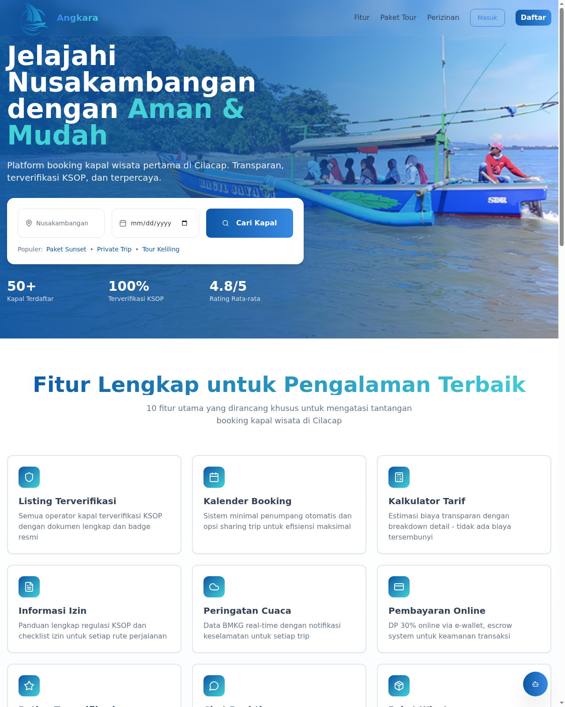
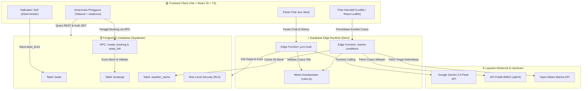

<div align="center">

# 🛥️ ANGKARA (Angkutan Segara)
### *Platform Reservasi Wisata Maritim Terpadu & Asisten Keselamatan Berlayar Cerdas*

[](https://github.com/MuhammadHadistRifannan/Angkara/actions/workflows/ci.yml)
[](https://github.com/MuhammadHadistRifannan/Angkara/actions/workflows/deploy.yml)
[](https://vitejs.dev/)
[](https://react.dev/)
[](https://www.typescriptlang.org/)
[](https://supabase.com/)
[](https://tailwindcss.com/)
[](https://deepmind.google/technologies/gemini/)

**Karya Inovasi Teknologi Maritim untuk Kompetisi IT RUSH 2026**  
*“Menghubungkan laut, memberdayakan nelayan pesisir, dan mengawal keselamatan wisatawan dalam satu gerakan digital terintegrasi.”*

[Demo Aplikasi](https://angkara-wia.netlify.app) • [Dokumentasi Deployment](docs/DEPLOYMENT.md) • [Laporan Arsitektur](2026-11-08-juru-mudi-design.md)

</div>

---

## 📌 Daftar Isi
1. [Latar Belakang & Masalah](#-latar-belakang--masalah)
2. [Solusi Inovatif: ANGKARA](#-solusi-inovatif-angkara)
3. [Tampilan Antarmuka & Ilustrasi](#-tampilan-antarmuka--ilustrasi)
4. [Fitur Unggulan](#-fitur-unggulan)
5. [Arsitektur Sistem & Alur Kerja](#-arsitektur-sistem--alur-kerja)
6. [Tech Stack](#-tech-stack)
7. [Panduan Instalasi & Menjalankan Lokal](#-panduan-instalasi--menjalankan-lokal)
8. [Pengujian & Verifikasi Kualitas](#-pengujian--verifikasi-kualitas)
9. [Profil Tim Pengembang](#-profil-tim-pengembang)
10. [Lisensi & Penafian](#-lisensi--penafian)

---

## 🌊 Latar Belakang & Masalah

Kawasan perairan pesisir Cilacap dan pulau Nusakambangan (seperti Teluk Penyu, Kampung Laut, dan Pelabuhan Tanjung Intan) memiliki potensi pariwisata bahari dan ekonomi maritim yang luar biasa. Namun, operasional pelayaran kapal wisata rakyat saat ini menghadapi berbagai tantangan krusial:

1. **Ketidakpastian Cuaca Maritim & Risiko Keselamatan**:  
   Wisatawan dan operator kapal kayu sering mengandalkan perkiraan kasat mata tanpa akses data gelombang laut dan kecepatan angin yang terukur. Cuaca ekstrem dapat berubah cepat dan membahayakan pelayaran.
2. **Proses Reservasi Tradisional & Rawan Overbooking**:  
   Pemesanan masih mengandalkan pencatatan manual atau pesan instan tanpa sinkronisasi ketersediaan kursi secara *real-time*, memicu ketidakpastian kapasitas dan potensi sengketa di dermaga.
3. **Ketidakterbukaan Tarif & Asimetri Informasi**:  
   Wisatawan luar daerah kerap menghadapi variasi tarif yang membingungkan tanpa rincian biaya yang transparan dan perlindungan uang muka (DP).
4. **Kepatuhan Dokumen Perizinan KSOP**:  
   Minimnya edukasi checklist kelaikan kapal dan izin operasional dari Kantor Kesyahbandaran dan Otoritas Pelabuhan (KSOP) bagi operator lokal.

---

## 💡 Solusi Inovatif: ANGKARA

**ANGKARA (Angkutan Segara)** mentransformasi ekosistem wisata maritim pesisir menjadi platform digital modern berbasis *Safety-First*. Aplikasi ini menyatukan:

- 🤖 **Juru Mudi AI**: Asisten pintar berbasis **Google Gemini 2.0 Flash** yang beroperasi secara *grounded* terhadap database kapal dan mesin keselamatan deterministik.
- 🌊 **Mesin Keselamatan Cuaca Maritim**: Penggabungan data resmi cuaca BMKG dan model maritim gelombang resolusi tinggi Open-Meteo.
- 🗺️ **Peta Interaktif Pesisir Cilacap**: Visualisasi geografis titik keberangkatan, kondisi gelombang per jam, dan rekomendasi jendela waktu pelayaran teraman.
- ⚓ **Reservasi Aman & Transparan**: Mesin booking berbasis transaksi atomik PostgreSQL RPC dengan proteksi kelebihan muatan (*anti-overbooking*) dan kontrol akses ketat (*Row Level Security*).

---

## 🖼️ Tampilan Antarmuka & Ilustrasi

### 1. Peta Maritim Interaktif & Pemantau Keselamatan Titik Keberangkatan
Peta geografis resolusi tinggi berbasis Leaflet yang memetakan titik-titik dermaga (Teluk Penyu & Pelabuhan Tanjung Intan), disertai panel ringkasan kondisi maritim dan status keselamatan pelayaran.



> [!TIP]
> **Status Keselamatan Deterministik**: Sistem mengevaluasi kondisi gelombang (ambang batas kapal nelayan: 1,25 m), angin (15 knot), hujan lebat, dan petir untuk menghasilkan status **Aman**, **Waspada**, atau **Tunda**. Jika data gelombang tidak tersedia (*unavailable*), status maksimal adalah **Waspada** dan tidak pernah mengizinkan status Aman.

---

## 🚀 Fitur Unggulan

### 1. 🤖 Asisten Pintar “Juru Mudi” (Gemini 2.0 Flash + Tool Calling)
- **Domain Khusus Maritim Cilacap**: Melayani pertanyaan rekomendasi kapal, jadwal pelayaran, estimasi tarif, perizinan KSOP, dan kondisi cuaca.
- **Keselamatan Deterministik**: Asisten dilarang mengarang atau melunakkan status cuaca. Semua status keselamatan dihitung murni oleh aturan matematis sistem.
- **Kartu UI Interaktif Terstruktur**: Agen mengembalikan kartu interaktif kaya (*Boat Options*, *Weather Verdict*, *Safest Window*, dan *Booking Draft*) yang diverifikasi skema Zod.
- **Pertahanan Anti-Injeksi Prompt**: Dilindungi dari upaya manipulasi pengguna (misal: memaksa asisten menyatakan kondisi aman saat cuaca berbahaya).

### 2. 🗺️ Pemantauan Cuaca Maritim Multi-Sumber
- **Integrasi BMKG**: Memanfaatkan data resmi cuaca berbasis kode wilayah kelurahan/desa pesisir (`adm4`).
- **Model Gelombang Open-Meteo Marine**: Mengambil parameter tinggi gelombang laut (*wave height*) dan kecepatan angin maritim.
- **Jendela Pelayaran Teraman (*Safest Departure Window*)**: Menganalisis rentang jam operasional optimal (07.00–15.00 WIB) untuk menentukan hari dan jam terbaik berlayar.

### 3. 💰 Kalkulator Tarif Transparan (Fare Calculator)
- Mengambil data dasar kapal riil dari database (bukan nilai fiktif).
- Skema diskon rombongan transparan:
  - Jumlah penumpang $\ge 10$ orang: diskon **10%**
  - Jumlah penumpang $\ge 20$ orang: diskon **15%**
- Penjelasan rincian estimasi biaya secara terbuka sebelum wisatawan melakukan pemesanan.

### 4. ⚓ Mesin Booking Atomik (PostgreSQL RPC `create_booking`)
- Transaksi database terkunci (*row-level locking* `SELECT FOR UPDATE`) untuk mencegah perebutan kursi (*race condition*).
- Menghitung sisa kursi otomatis dengan fungsi `seats_left()`.
- Error mapping berbahasa Indonesia: menangani penolakan jika kursi tidak cukup, tanggal lampau, kapal tidak beroperasi, atau belum masuk akun.

### 5. 🔐 Autentikasi Pengguna & Operator
- Dukungan **Masuk dengan Google (OAuth 2.0)** dan email/password melalui Supabase Auth.
- Pemisahan hak akses berbasis peran (*Role-Based Access Control*): Wisatawan, Operator Kapal, dan Administrator.

---

## 🏗️ Arsitektur Sistem & Alur Kerja

Berikut adalah arsitektur aliran data menyeluruh aplikasi ANGKARA:



---

## 🧰 Tech Stack

| Kategori | Teknologi yang Digunakan | Keterangan & Peran |
| :--- | :--- | :--- |
| **Frontend Framework** | **Vite 5 + React 18** | *Single Page Application* (SPA) dengan performa tinggi |
| **Bahasa Pemrograman** | **TypeScript 5.8** | *Type safety* penuh dari antarmuka hingga kontrak backend |
| **UI & Styling** | **Tailwind CSS + shadcn/ui** | Desain responsif, modern, dan aksesibel |
| **Peta & Visualisasi** | **Leaflet + React-Leaflet + Recharts** | Peta interaktif maritim dan grafik prakiraan cuaca |
| **Backend & BaaS** | **Supabase (PostgreSQL 15)** | Relasional DB, RLS, Storage, Auth, dan RPC atomik |
| **Serverless Runtime** | **Deno (Supabase Edge Functions)** | Menjalankan *microservices* `juru-mudi` & `marine-conditions` |
| **Kecerdasan Buatan (AI)** | **Google Gemini 2.0 Flash** | Model LLM cerdas untuk penalaran agen dan pemanggilan tool |
| **Data Cuaca Eksternal** | **BMKG & Open-Meteo API** | Sumber data cuaca resmi kelurahan dan model gelombang laut |
| **Unit Testing** | **Vitest 2.1 + Testing Library** | Disiplin *Test-Driven Development* (TDD) dengan 146+ unit test |
| **CI/CD & Hosting** | **GitHub Actions + Netlify** | Otomatisasi pengujian, *typecheck*, *build*, dan *zero-downtime deployment* |

---

## ⚙️ Panduan Instalasi & Menjalankan Lokal

### Prasyarat
- **Node.js**: versi `20.x` atau `22.x` (direkomendasikan Node 22 LTS)
- **NPM**: bawaan Node.js
- Git terpasang di sistem operasi Anda

### 1️⃣ Clone Repository
```bash
git clone https://github.com/MuhammadHadistRifannan/Angkara.git
cd Angkara
```

### 2️⃣ Install Dependensi
```bash
npm ci
```

### 3️⃣ Konfigurasi Environment Variables
Salin berkas contoh konfigurasi lingkungan:
```bash
cp .env.example .env
```
Lalu lengkapi nilai konfigurasi Supabase Anda di dalam `.env`:
```env
VITE_SUPABASE_PROJECT_ID="your-project-id"
VITE_SUPABASE_URL="https://your-project-id.supabase.co"
VITE_SUPABASE_PUBLISHABLE_KEY="your-anon-key"
```

### 4️⃣ Jalankan Server Pengembangan Lokal
```bash
npm run dev
```
Buka browser Anda di `http://localhost:5173`.

---

## 🧪 Pengujian & Verifikasi Kualitas

Proyek ini dibangun dengan komitmen kualitas tinggi dan disiplin **Test-Driven Development (TDD)** yang ketat:

```bash
# Menjalankan seluruh test suite unit & integrasi (Vitest)
npm test

# Menjalankan verifikasi tipe TypeScript tanpa emit berkas
npm run typecheck

# Menjalankan linter kode
npm run lint

# Menjalankan build bundle produksi
npm run build

# Menjalankan suite evaluasi agen juru-mudi (Task 12)
EVAL_URL=https://<project-ref>.supabase.co/functions/v1/juru-mudi EVAL_ANON_KEY=<anon-key> npm run eval
```

> [!NOTE]
> Proyek memiliki **23 berkas tes dengan 146 unit test** yang mencakup mesin keselamatan maritim, format perizinan KSOP, perhitungan tarif, penanganan galat RPC booking, komponen UI peta, dan mesin assertion evaluasi AI.

---

## 👥 Profil Tim Pengembang

Karya ini dirancang dan dikembangkan dengan penuh dedikasi untuk kompetisi **IT RUSH 2026**:

<div align="center">

### 🏆 **Tim Katanya Ini Vibe Coder Semua**
*Kolaborasi Mahasiswa Pesisir untuk Transformasi Digital Maritim*

| Foto | Profil Anggota | Asal Instansi | Peran & Tanggung Jawab |
| :---: | :--- | :--- | :--- |
| 👨‍💻 | **Muhammad Hadist Rifannan**<br>`NIM: 240202107` | **Politeknik Negeri Cilacap** | **Ketua Tim / Full-Stack & AI Engineer**<br>• Arsitektur Sistem & Integrasi Edge Functions<br>• Mesin Keselamatan Cuaca & Gemini Agent<br>• Database Schema, RPC, & CI/CD Pipeline |
| 🎨 | **Giska Saputra** | **Politeknik Negeri Cilacap** | **Anggota / Frontend & UI/UX Developer**<br>• Desain Antarmuka Pengguna & Komponen Visual<br>• Implementasi Peta Interaktif & Responsivitas Mobile<br>• Pengujian Fungsionalitas & Pengalaman Pengguna |
| 🛠️ | **Rafi Praja Syahputra**<br>`NIM: K2324014` | **Universitas Sebelas Maret** | **Anggota / System & Quality Assurance**<br>• Evaluasi Integritas Sistem & Pengujian Performa<br>• Riset Standar Regulasi & Dokumen Perizinan KSOP |
| 📊 | **Abdul Fattah Nagata J. N.**<br>`NIM: K2324022` | **Universitas Sebelas Maret** | **Anggota / Data Analyst & Domain Research**<br>• Analisis Data Cuaca BMKG & Pemetaan Wilayah<br>• Riset Tarif, Kapasitas Kapal, & Dokumentasi Teknis |

</div>

---

## 📄 Lisensi & Penafian

- **Lisensi**: Proyek ini dilisensikan di bawah [MIT License](LICENSE).
- **Penafian Data Cuaca**: Data cuaca diperoleh dari Badan Meteorologi, Klimatologi, dan Geofisika (BMKG) serta model laut Open-Meteo. Informasi keselamatan pelayaran yang disajikan oleh asisten AI ditujukan sebagai panduan pendukung keputusan dan edukasi keselamatan (*decision-support system*), bukan pengganti instruksi resmi syahbandar pelabuhan (KSOP) setempat.

---

<div align="center">
  <sub>Dibuat dengan ❤️ dan semangat gotong royong masyarakat pesisir Cilacap • 2026</sub>
</div>
